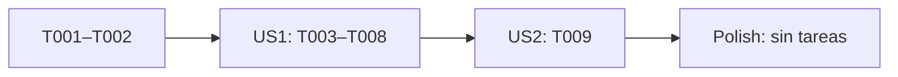

# Tasks: Internacionalización

**Input**: Documentos de diseño de `specs/003-internationalization/`

**Prerequisites**: `plan.md`, `spec.md`, `research.md`, `data-model.md`, `contracts/`

**Tests**: No se solicitaron pruebas automatizadas; se omiten tareas para crearlas. Los criterios de aceptación y comandos de validación están en `quickstart.md`.

**Organization**: Tareas agrupadas por historia de usuario para entregar incrementos utilizables.

## Phase 1: Setup

**Purpose**: No requiere inicialización del proyecto ni cambios de dependencias; Next.js, TypeScript y Zod ya están configurados.

---

## Phase 2: Foundational

**Purpose**: Tipos y textos compartidos que necesitan las dos historias.

- [x] T001 Definir los idiomas soportados (`es` y `en`), su validación y la resolución de preferencia, `Accept-Language` y respaldo español en `src/shared/i18n/locale.ts`
- [x] T002 Crear catálogos completos de español e inglés con las mismas claves para textos de interfaz, errores y validaciones actuales, usando español como fallback en `src/shared/i18n/translations.ts`

**Checkpoint**: Los idiomas y sus textos están disponibles para las pantallas y los endpoints.

---

## Phase 3: User Story 1 - Usar la interfaz en el idioma preferido (Priority: P1) 🎯 MVP

**Goal**: Mostrar la interfaz actual en español o inglés y permitir cambiar de idioma mientras se conserva la pantalla y el estado de trabajo.

**Independent Test**: En un perfil limpio, abrir la aplicación con preferencias de navegador español, inglés y un idioma no soportado. Confirmar el idioma inicial y `html lang`; cambiar de idioma desde login y desde incidencias; revisar etiquetas, errores, validaciones, controles accesibles y formatos; comprobar que la ruta, filtros y página actual se conservan.

### Implementation

- [x] T003 [P] [US1] Resolver el idioma inicial para el documento, establecer `html lang` y localizar título y descripción de página en `src/app/layout.tsx`
- [x] T004 [P] [US1] Mostrar el catálogo activo en la página de login y traducir formulario, validaciones, estados y errores de sesión en `src/app/login/page.tsx` y `src/modules/auth/components/login-form.tsx`
- [x] T005 [P] [US1] Mostrar el catálogo activo en incidencias, traducir filtros, paginación, estados, controles accesibles y errores, y formatear fechas y números con `Intl` en `src/app/issues/page.tsx` y `src/modules/issues/components/issue-list.tsx`
- [x] T006 [P] [US1] Devolver los mensajes de error de sesión, incidencias y filtros en el idioma activo, manteniendo códigos HTTP y respuestas exitosas en `src/modules/auth/handlers/session-route.ts`, `src/modules/issues/handlers/issues-route.ts` y `src/modules/issues/handlers/issue-filters-route.ts`
- [x] T007 [P] [US1] Crear `POST /api/locale` que valide el cuerpo de entrada con un esquema Zod que admita solo `es` o `en`, valide el origen y guarde la selección del navegador en `src/app/api/locale/route.ts`
- [x] T008 [US1] Crear un selector accesible en login e incidencias con estados pendiente, éxito y error; refrescar la ruta solo después de guardar correctamente, y ante un fallo conservar idioma, ruta, filtros, página y sesión, mostrar un error recuperable y permitir reintentar en `src/shared/i18n/locale-switcher.tsx`, `src/app/login/page.tsx` y `src/modules/issues/components/issue-list.tsx` (depende de T003–T007)

**Checkpoint**: Login e incidencias pueden usarse íntegramente en ambos idiomas; cambiar el idioma conserva la ruta y el estado activo.

---

## Phase 4: User Story 2 - Conservar la preferencia de idioma (Priority: P2)

**Goal**: Mantener la elección del usuario después de cerrar y volver a abrir el navegador.

**Independent Test**: Elegir inglés con el navegador configurado en español y repetir diez veces el cierre y reapertura del navegador; en las diez visitas confirmar que inglés prevalece. Repetir con una preferencia guardada inválida y confirmar que se aplica el idioma del navegador o español como respaldo.

### Implementation

- [x] T009 [US2] Hacer persistente por un año la cookie `locale`, con `Path=/`, `HttpOnly`, `SameSite=Lax` y `Secure` bajo HTTPS, en `src/app/api/locale/route.ts`

**Checkpoint**: La preferencia válida sobrevive a nuevas visitas en el mismo navegador y prevalece sobre `Accept-Language`.

---

## Phase 5: Polish & Cross-Cutting Concerns

**Purpose**: Las comprobaciones de aceptación y los comandos `pnpm lint` y `pnpm build` están documentados en `quickstart.md`; no se requieren tareas adicionales compartidas.

---

## Dependencies & Execution Order

### Phase Dependencies

- **Setup (Phase 1)**: No contiene tareas; el proyecto ya está configurado.
- **Foundational (Phase 2)**: Completar T001 y T002 antes de las historias.
- **User Story 1 (Phase 3)**: Depende de la base. T003–T007 pueden implementarse en paralelo; T008 requiere que el selector pueda usar la resolución, catálogos, endpoint y pantallas.
- **User Story 2 (Phase 4)**: Depende de US1 y actualiza el endpoint creado en T007.
- **Polish (Phase 5)**: Sin tareas propias.

### User Story Dependencies

- **US1 (P1)**: Depende solo de la fase Foundational y es el MVP.
- **US2 (P2)**: Depende de US1 porque extiende la cookie que ya se usa al cambiar el idioma.



### Parallel Opportunities

- T001 precede a T002 porque los catálogos usan los tipos de idioma definidos en `locale.ts`.
- En US1, T003, T004, T005, T006 y T007 modifican rutas o módulos distintos y pueden trabajarse en paralelo después de la fase Foundational.
- T008 se hace después de T003–T007 porque monta el selector en archivos que también actualiza T004 y T005.
- US2 tiene una única tarea y se ejecuta después de US1.

## Parallel Example: User Story 1

```text
Después de T001 y T002:
Grupo A: T003 — layout y metadata
Grupo B: T004 — login y formulario
Grupo C: T005 — incidencias y formatos
Grupo D: T006 — mensajes de los endpoints
Grupo E: T007 — endpoint de preferencia
Después de esos grupos: T008 — selector y actualización de pantalla
```

## Implementation Strategy

### MVP First (User Story 1)

1. Completar T001–T002.
2. Implementar T003–T007 en paralelo y luego T008.
3. Recorrer los criterios independientes de US1 descritos en esta fase y en `quickstart.md`.
4. US1 entrega una interfaz bilingüe con cambio de idioma durante el uso.

### Incremental Delivery

1. Completar Foundation y US1 para entregar el cambio de idioma en las pantallas actuales.
2. Completar US2 para conservar la elección durante visitas posteriores.
3. Seguir `quickstart.md` para validar ambas historias y ejecutar lint y build.

## Notes

- `[P]` indica tareas que pueden hacerse en paralelo sin editar los mismos archivos.
- `[US1]` y `[US2]` corresponden a las historias de usuario de `spec.md`.
- La preferencia no se asocia a la cuenta Redmine y el contenido de incidencias no se traduce.
